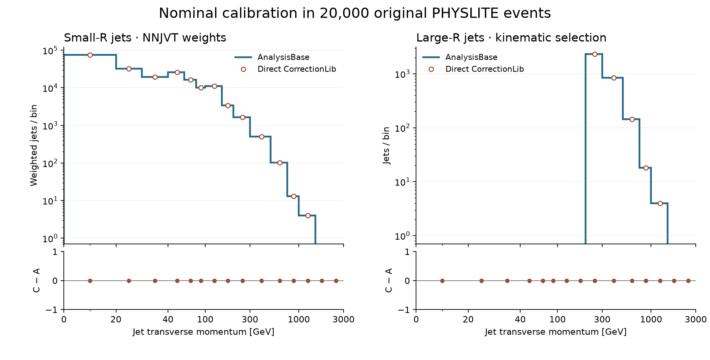
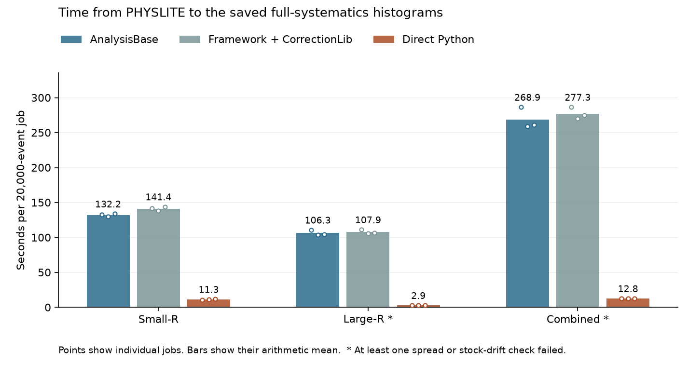

# Recalibrating small- and large-radius ATLAS jets from PHYSLITE

Can one CorrectionLib implementation reproduce both jet calibrations and make the analysis faster? We compared the CP tools in AnalysisBase 25.2.117 with a CorrectionLib replacement in AnalysisBase and a standalone Python analysis. On 20,000 Run 3 PHYSLITE events containing 196,606 small-R and 22,177 large-R jets, the two converted paths agreed with the original calibrated coordinates, selections, weights and available validity flags. The comparison covers nominal calibration and all 119 small-R and 219 large-R states in the tested uncertainty models, including nominal. All saved transverse-momentum histograms agreed, including underflow, overflow and sums of squared weights. [Framework comparison](evidence/final/B-combined/observer-comparison.json) · [Direct object comparison](evidence/final/C-both/comparison.json) · [Saved histogram comparison](evidence/final/shipped-both/comparison.json)

**A** runs the stock CP tools. **B** runs the same AnalysisBase job with CorrectionLib supplying the jet calculations. Both write an analysis ntuple, which a second process reads to fill and save the histograms. **C** reads the original PHYSLITE with uproot, calls the same converted calculations, and saves the histograms in one Python process. The columnar jobs below include startup and payload loading.

| Workload | A · Stock total (s) | B · Framework replacement total (s) | C · Standalone total (s) | A/C | Comment |
| --- | ---: | ---: | ---: | ---: | --- |
| Small-R, full systematics | 132.19 ± 2.00 | 141.42 ± 2.98 | 11.30 ± 0.42 | **11.70×** | A/C qualified in the production grid. |
| Large-R, full systematics | 106.29 ± 4.00 | 107.91 ± 2.95 | 2.876 ± 0.085 | 36.96× | Stock spread exceeded the limit. The A/C recheck qualified at **33.85×**. |
| Both, full systematics | 268.91 ± 15.38 | 277.32 ± 8.48 | 12.832 ± 0.003 | 20.96× | Stock spread exceeded the limit. The A/C recheck qualified at **20.09×**. |

The table uses the same three retained production rounds for A, B and C, with one analysis thread pinned to CPU 3. Values are arithmetic means ± sample standard deviation. The relative spread is the sample standard deviation divided by the mean. We allowed up to 5% spread, 10% deviation of any retained time from its cohort median, and 10% deviation for the stock brackets. The paired rechecks in the comments measured A and C separately from the production grid. All three qualified A/C results met the 10× goal. [Full timings and quality checks](timing-results.md) · [Large-R recheck](evidence/timing/recheck-AC-large-full-001/summary.json) · [Combined recheck](evidence/timing/recheck-AC-combined-full-001/summary.json)

The framework replacement qualified within its 1.20× budget in four of six nominal and full-systematics tests. Small-R nominal and combined full each measured about 1.04× stock on recheck. Small-R nominal still exceeded the stock spread limit, and the combined full opening stock bracket exceeded the drift limit. Both decisions remain unresolved. [Framework budget details](#framework-budget) · [All bounded comparisons](timing-results.md#bounded-paired-rechecks)

[Testing setup](#testing-setup) · [Validation and plots](#validation) · [Adopted optimizations](#adopted-optimizations) · [Code and how to run it](#code-and-how-to-run-it) · [Full Path C Python script](#complete-path-c-script) · [Wheel contents](#standalone-package) · [Twenty future experiments](#twenty-optimization-ideas-to-try-next)

## Testing setup

The input is one MC23a full-simulation top-pair PHYSLITE file for DSID 601229, processing tag p7266. We read entries 0–19,999 of `CollectionTree` in original order, including 6,533 events without a large-R jet. The stock implementation is AnalysisBase 25.2.117, Athena commit `6ce3f7ae7c41dd9eaec170c3c349df15faef7e5c`. The replacement uses the CorrectionLib fork at `3dcfa20ec01fb40c4d5fec58383785519dec1c00`, with a separately verified full-precision JSON parser patch. [Input identity and digest](evidence/final/source/jets-input.json) · [Release and toolchain pins](evidence/intake/sources.json) · [Parser reproduction](evidence/diagnostics/full-precision-parser.json)

| Collection | Nominal preparation | Executed uncertainty model |
| --- | --- | --- |
| Small-R anti-kₜ R = 0.4 particle-flow jets | Recalibrate PHYSLITE; apply pile-up, the energy scale as a function of pseudorapidity (EtaJES), and global sequential calibration. Update NNJVT and apply its fixed-efficiency working point and scale factors. | Category JES and full JER. The 119 states comprise nominal, 60 signed energy-scale states, 28 ordinary and 28 pseudo-data energy-resolution states, and two NNJVT weight states. |
| Large-R anti-kₜ R = 1.0 soft-drop UFO jets | Recalibrate PHYSLITE from constituent scale through EtaJES and jet mass scale (JMS). Apply separate transverse-momentum/rapidity and mass selections. | Category JES, full JER, full JMS and full JMR (mass resolution). The 219 states comprise nominal, 64 energy-scale and topology states, 30 ordinary and 30 pseudo-data JER states, 58 JMS states and 36 forward-folded JMR states. |

Small-R explicitly requests category JES. For large-R, the configuration leaves JES at the release's category default, verified against the initialized tools. The requested unreduced small-R JES configuration failed to initialize because the release's Run 3 calibration area lacks the required file. The supported category scheme groups JES components while retaining the full JER model. Both collections disable ghost-muon association, and small-R disables the legacy JVT update and selection and forward JVT selection. The 331 distinct combined labels count seven shared labels once. Nominal-only runs disable variations. The read-without-corrections control reads persisted quantities and still pays for startup and output. [Executed state order](evidence/reference/jet-states.json) · [Initialized tool properties](evidence/reference/initialized-tools.tsv) · [Small-R source](small-source.md) · [Large-R source](large-source.md)

The small-R histogram uses the NNJVT pass or fail scale factor as the per-jet weight, with unit weight for an out-of-validity jet. Large-R jets enter with unit weight when they satisfy 200 ≤ pT < 3,000 GeV, absolute rapidity ≤ 2, and 40 ≤ mass < 600 GeV. Both workflows fill GeV pT and a category axis for each collection's state names. The two small-R weight-only states use nominal kinematics. [Histogram definitions and input contract](evidence/intake/workload.json)

## Implementation

The first validated replacement reused the AnalysisBase uncertainty code. That code expects a jet record and an event record in the xAOD format AnalysisBase uses. When an uncertainty request reached that code, the adapter built short-lived records in memory from values it already had, such as the jet's four-vector and the event's pile-up and primary-vertex count. The adapter repeated that preparation for each applicable jet and systematic state. The delivered evaluator takes those values directly, looks up the exported uncertainty tables, and applies the same calculations, validity checks and seeded random draws. The direct Python path also avoids the ntuple write and reread by filling histograms from the evaluated columns. [Release tool and call sites](evidence/source/source-provenance.json) · [Source revisions and files](#inspect-the-uncertainty-source)

The final CorrectionSet holds 15 named corrections. A CorrectionLib node is one component of an evaluation, such as a bin lookup or a registered C++ calculation. The small-R NNJVT scale factors use the standard multidimensional binning node. Custom nodes in `libjets.so` handle operations such as EtaJES, uncertainty groups and forward-folded mass resolution. The payload supplies the release coefficients, bin geometry, uncertainty group definitions and trained network. The provider implements the release's numerical and boundary rules and uses lwtnn 2.14.1 for the NNJVT inference. EtaJES and ordinary uncertainty evaluation share one implementation across radii, with collection-specific parameters. Small-R pile-up, the global sequential calibration and NNJVT have separate correction entry points, as do large-R mass calibration and resolution. [Correction inventory and payload closure](evidence/diagnostics/manifest.json) · [Calibration source and data provenance](evidence/final/source/calibration-provenance.json)

AnalysisBase continues to configure the CP tools, traverse systematic states, copy and decorate xAOD jets, and write ROOT branches. Its adapter passes jet and event values to the registered nodes and writes their returned values and statuses. The standalone script uses uproot and Awkward for input and transport. It chooses the correction for each stage, passes scalar settings and array columns through CorrectionLib, and fills the histograms in Python. Python owns the order of the analysis stages and the loops over chunks and states. The provider owns the numerical stages, including group evaluation within an uncertainty call. Direct Python owns truth coordinates for each chunk, which supports reuse of the large-R truth match. AnalysisBase supplies a temporary view and uses the uncached branch of the same matcher. [Framework call and input-lifetime audit](evidence/diagnostics/framework-execution.json) · [Loaded framework libraries and runtime proof](evidence/final/B-combined/process-verification.json) · [Shipped Python script](delivery/jets_demo.py)

### Inspect the uncertainty source

The commits below are in the local WSL `atlas_al9` checkout at `/home/gwatts/atlas-cp-speed/jets-skill-c8a2374-20261117`. The first is the archived release-backed source used in the later matched progression. The second introduces the direct evaluator. The third is the recorded source of the delivered native provider. [Release-backed source receipt](evidence/timing/progression/provenance.json) · [Delivered provider build receipt](evidence/diagnostics/trials/selected-stack-index.json)

| Implementation | Full Git commit | File to inspect |
| --- | --- | --- |
| Release-backed evaluator | `7b296d18d48f2c4a4105ba387141c6edccd86bcf` | `provider/jet_uncertainty.cxx`, where `evaluate` builds the xAOD records |
| First direct evaluator | `9fda0238efc9546137d2acbfcfce174c7633042a` | `portable/uncertainty.cxx`, where `evaluate` consumes the numerical inputs |
| Delivered native evaluator | `02c25d9dc4625912c56a9990899064b9d8cf13c8` | `provider/uncertainty_node.cxx` for CorrectionLib dispatch and `portable/uncertainty.cxx` for evaluation |

Read any of these files at its recorded revision with `git show <commit>:<file>` from the WSL checkout. The tracked source ZIP also includes the delivered evaluator. [Windows source archive](evidence/source/jet-conversion-source.zip) · [Archive revision and hash](evidence/source/jet-conversion-source.json)

## Validation

We compared calibrated pT, pseudorapidity, azimuth and mass against stock, along with the recorded intermediate stages, NNJVT scores and scale factors, selections and validity. The framework comparison checks stored value bytes and event offsets. The direct object comparison requires numerical equality with zero absolute and relative tolerance, treats NaNs at the same position as equal, and treats positive and negative zero as equal. The checks cover both radii separately and together. The combined framework and direct checks reconcile all 7,189 public observer branches, including aliases and derived values. [Framework object comparison](evidence/final/B-combined/observer-comparison.json) · [Direct object values](evidence/final/C-both/comparison.json) · [Direct alias and energy reconciliation](evidence/final/C-both/observer-aliases.json) · [Independent single-radius receipts](evidence/final/manifest.json)

Two early discrepancies explained choices in the final implementation. Reading inclusive particle-flow energy density instead of the neutral density requested by the stock pile-up tool shifted the first small-R jet's pT by 604 MeV. Using the configured neutral branch resolved it. An early EtaJES check found 27 small-R mass differences up to 0.01105 MeV. The pinned JSON reader rounded nine binary64 coefficients differently. A full-precision parser fixed the coefficient reads, and the full-file stage checks then agreed. [Input diagnosis](evidence/validation/full-direct/comparison.json) · [First stage comparison](evidence/validation/first-stage-diagnostics/agreement.json) · [Corrected stage comparison](evidence/validation/stages-precision/agreement.json)



Lines show stock and open circles show direct Python on the same physical bins. The lower panels show direct minus stock. The nominal large-R selection accepts 3,302 of 22,177 original jets. The saved-histogram check found exact agreement also for every varied bin, counts, weighted contents, squared weights and flows. Object plots use all original jets before the final selection. Small-R energy is checked against the separate stock energy branch in 117 states. The two weight-only states have no independent energy branch. The large-R observer records the four-vector coordinates and has no separate energy branch. [Small-R coordinates](figures/sr-coordinates.png) · [Large-R coordinates](figures/lr-coordinates.png) · [Small-R energy](figures/sr-energy.png) · [NNJVT and weights](figures/sr-weights.png) · [Selections and validity](figures/selection-validity.png) · [Representative variations](figures/representative-shifts.png) · [All-state summary](figures/all-state-agreement.png) · [Binning, entries and flows](evidence/final/metadata.json)

## Performance

### From the first conversion to the shipped workflow

The first A/B/C rotation exercised the read-without-corrections, nominal and full-systematics workloads. In its excluded combined full-systematics warm-up, stock A took 338.58 s, release-backed B took 443.14 s and direct C took 69.08 s. Compiler activity made those observations unsuitable for a production speed claim. They established a working baseline and pointed to repeated object construction in the converted uncertainty calls. [First validated A/B/C rotation](evidence/timing/faithful/round-zero-only.json)

We later reran the first, release-backed C workflow in the same session as the intermediate packed wheel and final wheel. All three implementations used the original random stream, read identical branches within each scope, and reproduced the stock histograms. Each entry is the mean ± sample standard deviation of three retained jobs. This measures the combined effect of the numerical, loading and workflow changes. [Matched progression and results](evidence/timing/progression/summary.json) · [Commands and full revision identities](evidence/timing/progression/provenance.json)

| Full-file direct workflow | First C, later rerun (s) | Intermediate packed wheel (s) | Shipped C (s) | First / shipped |
| --- | ---: | ---: | ---: | ---: |
| Small-R | 54.251 ± 0.512 | 13.824 ± 0.464 | 11.282 ± 0.284 | 4.81× |
| Large-R | 12.142 ± 0.103 | 3.698 ± 0.062 | 2.805 ± 0.011 | 4.33× |
| Both | 60.622 ± 0.385 | 15.235 ± 0.100 | 12.919 ± 0.208 | 4.69× |

### Adopted optimizations

The comparisons below time one change at a time unless the row identifies a combined build. All use the full 20,000-event input, the original random stream and an exact stock-histogram check. Most give three retained fresh runs. Different rows start from different builds, so the first-to-final table above measures the total gain. The table names the scopes for the measured C improvement. Some native routines also serve scalar B calls. [Complete attempt and acceptance register](optimization-register.md) · [Final native build and workflow settings](evidence/final/source/qualification-specification.json) · [Accepted runtime identities](evidence/final/manifest.json)

| Change in the shipped implementation | Matched C wall time and conclusion |
| --- | --- |
| **Evaluate uncertainties from the jet and event quantities already in hand** in B and C. The first adapter packed those quantities into AnalysisBase records for each applicable call. The shared evaluator now uses the values directly with the exported uncertainty tables. | Combined **63.101 → 23.090 s** (40.011 s saved), small-R **54.465 → 20.757 s** (33.708 s saved). The large-R baseline exceeded the spread limit. This comparison measures the whole evaluator replacement. [Repeated measurements](evidence/timing/engineering/original-stream-pairs.json) · [Full acceptance of the portable tables](evidence/portable/full-comparison.json) · [Git commits and source files](#inspect-the-uncertainty-source) |
| **Cache the first Gaussian variate for each positive seed** in the shared resolution code. Multiply by the state-specific width as before. Negative factors still take the original rejection sequence. The shipped cache holds 4 MiB per thread. | Adding the 1 MiB cache saved **4.357 s** combined (**23.090 → 18.733 s**) and **3.516 s** for small-R (**20.757 → 17.241 s**). Increasing capacity to 4 MiB in a later cohort saved **0.984 s** combined (**17.221 → 16.237 s**). [Initial cache and exact stock checks](evidence/timing/engineering/original-stream-pairs.json) · [Capacity comparison and provider identities](evidence/diagnostics/trials/rotated-mechanisms.json) · [Original-stream fixture, `7d0a6b9`](evidence/diagnostics/rng-fixture/portable-cache.check.txt) |
| **Reuse an unchanged small-R NNJVT network result** in C. Reuse applies when pT and pseudorapidity match nominal bitwise and the chunk's invariant inputs are unchanged. State-specific cuts, scale factors and weights still run. | Small-R **17.241 → 15.711 s** (1.530 s saved); combined **18.733 → 17.686 s** (1.047 s saved). [Repeated jobs, `8c4b46a`](evidence/timing/engineering/original-stream-pairs.json) · [Independent object agreement](evidence/validation/original-stream-cache/C/comparison.json) |
| **Pack EtaJES response cells as exact binary32 values.** B and C decode the stored table bits and keep the original bin geometry and coefficients. | Combined **17.221 → 15.208 s** (2.013 s saved), small-R **16.124 → 14.145 s** (1.979 s saved), large-R **5.599 → 3.774 s** (1.825 s saved). [Repeated jobs](evidence/diagnostics/trials/rotated-mechanisms.json) · [Exact packed cells, `2d24f53`](evidence/diagnostics/eta-jes-packing.json) |
| **Classify variable-axis flow before searching inner bins** in the shared table evaluator. Compare with the outer edges when the answer needed is whether the coordinate lies outside the axis. | Combined **17.221 → 16.829 s** (0.392 s saved), small-R **16.124 → 14.912 s** (1.212 s saved), large-R **5.599 → 5.475 s** (0.124 s saved). [Repeated jobs](evidence/diagnostics/trials/rotated-mechanisms.json) · [Exact ROOT comparisons, `47ca919`](evidence/diagnostics/trials/joint-fixtures-001.json) |
| **Use only the requested radius's payload in single-radius C.** Construct that document from verified ranges in the canonical file. The times include the temporary write. B loads the equivalent prebuilt subset. | Small-R **13.960 → 13.574 s** (0.386 s saved), with the difference comparable to run-to-run scatter. Large-R **3.647 → 3.261 s** (0.386 s saved). Representative peak memory dropped by 77 and 87 MiB respectively. [Small-R repeat](evidence/diagnostics/loading-repeat/small.json) · [Large-R repeat](evidence/diagnostics/loading-repeat/large.json) · [Exact scope reconstruction, `fa0b357`](evidence/final/source/partition.json) |
| **Reuse unsigned uncertainty components for adjacent up/down states** in small-R and combined C. Each state keeps its own signed response, application order and output. | On the final native build, enabling reuse changed combined **13.424 → 13.112 s** (0.312 s saved). The earlier small-R screen favored the change but the control with the signed interface dormant exceeded the spread cap. The selected small-R route passed full qualification. Standalone large-R uses ordinary evaluation because its repeated pairs disagreed on the direction of the gain. [Final paired comparison, `02c25d9`](evidence/diagnostics/trials/selected-stack-both.json) · [Signed-state fixture, `05eb0d4`](evidence/diagnostics/structural/sign-fixture.json) |
| **Generate only the needed MT19937 prefix on a positive-seed cache miss.** The same raw words feed the Gaussian sampler, with continuation through the original full engine if needed. | With prebuilt packed inputs small-R **11.414 → 11.018 s** (0.396 s saved); combined **13.860 → 13.437 s** (0.423 s saved). Large-R timing did not establish a gain. [Matched prebuilt-input jobs and provider revisions](evidence/diagnostics/trials/packed-recombination-index.json) · [Generator equivalence, `9762cb3`](evidence/diagnostics/structural/rng-prefix-root.txt) |
| **Reuse nearest-truth matches and narrow irregular-axis searches.** Direct large-R keeps an owned chunk of truth jets across applicable mass-resolution variations. The shared table index narrows the search and falls back to the original search whenever needed. | At selected chunks and with prebuilt payloads, the final stack changed combined **13.250 → 13.112 s** (0.138 s saved) relative to the signed prefix-only build. Large-R went **2.873 → 2.819 s** after truth reuse, then **2.835 s** with the index. We selected the lowest combined mean and one provider for both radii. [Large-R trial](evidence/diagnostics/trials/selected-stack-large.json) · [Combined trial](evidence/diagnostics/trials/selected-stack-both.json) · [Full build identities, `02c25d9`](evidence/diagnostics/trials/selected-stack-index.json) |
| **Choose chunk size by scope.** Large-R C reads 4,000 events per chunk to reduce per-chunk preparation. Small-R and combined C use 1,000. | In the installed large-R repeat with actual payload construction, **3.394 → 3.022 s** (0.372 s saved). All three retained pairs favored the larger chunk. [Scoped chunk repeat, `d3011d6`](evidence/diagnostics/trials/large-chunk-repeat.json) · [All three scopes and peak memory](evidence/diagnostics/trials/installed-chunks.json) |

The final combined profile assigns 31.53% of sampled user CPU time to shared uncertainties and 15.28% to the small-R NNJVT update. It could not assign an owner to 13.56% of the samples. These are sampled CPU shares during repeated processing. The separate phase timings include startup, setup and output. A targeted follow-up eliminated eligible copies at the Python argument boundary, but the combined comparison went from 12.827 to 13.052 s and the qualified large-R repeat went from 2.805 to 2.907 s. We kept the existing copy policy and stopped tuning when the remaining ideas needed new ownership guarantees, evidence or changes to the execution contract. [Profile and phase study](profile-results.md) · [Combined copy trial](evidence/diagnostics/contiguous-arguments/first-comparison.json) · [Large-R copy recheck](evidence/diagnostics/contiguous-arguments/large-recheck.json) · [Stopping analysis](remaining-ideas.md)

### Framework budget

B replaces the numerical calculations and still does the framework work to initialize tools, manage systematic variations and decorate jets. In the combined full run, each of the two large-R selection algorithms can call the same node on a jet and recompute the cuts. The budget uses the framework time through ntuple writing. [Framework call trace](evidence/final/B-combined/framework-trace.txt) · [Timing records for all controls](timing-results.md)

| Scope | Nominal B/A framework | Full B/A framework |
| --- | ---: | ---: |
| Small-R | 1.009 → 1.041 · unresolved | 1.071 · within budget |
| Large-R | 1.022 · within budget | 1.019 · within budget |
| Both | 1.054 · within budget | 1.033 → 1.039 · unresolved |

Arrows give the original grid and the bounded recheck. In the small-R nominal recheck the stock framework's relative spread was 5.45%. In the combined full recheck B and A averaged 260.48 ± 3.37 s and 250.60 ± 2.80 s, with all three B/A pairs below 1.20. The opening stock bracket took 278.78 s, an 11.69% deviation from the retained stock median. Both unresolved cells had all observed pairs within budget. The timing evidence supports a budget decision only for the four passing cells. [Small-R nominal recheck](evidence/timing/recheck-AB-small-nominal-001/summary.json) · [Combined full recheck](evidence/timing/recheck-AB-combined-full-001/summary.json)

### Reading the collections together

In the production grid, the full C job took **12.83 s for both collections** versus **14.18 s for two separate jobs** (9.5% saved). B took 277.32 s jointly versus 249.34 s separately (11.2% longer). A also took longer jointly, with excess scatter in the combined jobs. The joint-versus-separate comparisons use the original grid and add the separate jobs from the same retained round. [Joint-versus-separate measurements](timing-results.md#combined-job-compared-with-two-standalone-jobs)

C reads 40 distinct ROOT leaves in a combined job. Seven of those leaves are present in both single-radius reads. The union saves counting 7.62 MB of compressed input baskets twice, or 17.1% of the separate total. B and A still write and reread effectively the sum of the two output ntuples. The observed joint stock file has 1,010 branches, the disjoint union of the 353 small-R and 657 large-R branches. [Input footprint and counting method](evidence/diagnostics/footprint.json) · [Stock branch and output-byte audit](evidence/diagnostics/joint-framework-scope.json)

| Full C input scope | Distinct ROOT leaves | Compressed basket bytes | Compressed kB/event | Uncompressed kB/event |
| --- | ---: | ---: | ---: | ---: |
| Small-R | 26 | 34,139,402 | 1.707 | 22.819 |
| Large-R | 21 | 10,554,871 | 0.528 | 16.726 |
| Both | 40 | 37,073,317 | 1.854 | 23.115 |

The input inventory counts baskets of the requested terminal branches once across all 20,000 events, including events without a selected jet, and includes basket headers. The uncompressed basis is serialized ROOT basket data. The numbers estimate input footprint, while cache and read behavior determine physical traffic. The control inventories distinguish the leaves requested by each mode. The stock and converted framework use release xAOD access and the separate ntuple read. The C leaf totals describe the uproot route. [Per-leaf inventory by mode](evidence/diagnostics/footprint.json) · [Executed input identities and counters](evidence/timing/production/compact.json)

### Timing conditions

The production grid has 112 accepted jobs and the bounded rechecks have 40. The monitors verified one execution thread on CPU 3 for accepted workers and detected no sampled muon-campaign CPU during the measured legs. The Windows counters describe the whole host. During the last combined framework recheck, available memory reached a minimum of 630 MiB. An earlier combined stock pilot recorded 131.18 s of CPU-slot I/O wait in its 521.44 s framework leg. The production grid interleaved the scopes and path order to reduce the effect of such variations. The monitor data establish the failed stock bracket and the host conditions. They leave the cause of the longer bracket unresolved. [Early stock pilot](evidence/timing/stock-pilots/single-pass.json) · [Original grid receipts](evidence/timing/production/compact.json) · [Production host and guest data](evidence/timing/production/host-summary.json) · [Recheck host and guest data](evidence/timing/recheck-AB-combined-full-001/host-summary.json)



The points are individual accepted production runs. The starred scopes had a spread flag in the production grid. The comments in the opening table give the qualified A/C rechecks for these scopes. [Machine-readable qualified decisions](talk/performance-reader.json)

## Standalone package

The ROOT-free delivery is one **36.078 MB** CPython 3.14 Linux x86-64 wheel and a separate **31,776-byte** example script. The wheel includes the matching CorrectionLib build. Public Python dependencies are separate downloads. The wheel provides the calibration data, evaluator, native jet provider and compiler runtimes. The table measures the delivered ZIP members directly. MB means 1,000,000 bytes. The uncompressed column adds member lengths and excludes the separately installed dependencies. [Wheel and runnable example](delivery/README.md) · [Exact package sizes, hashes and native dependencies](delivery/bundle.json) · [Loaded libraries in the isolated install](evidence/final/C-both/comparison.json)

| Wheel contents | Compressed (bytes) | Uncompressed members (bytes) |
| --- | ---: | ---: |
| Single calibration payload for both radii (`jets.json`) | 29,086,832 | 75,847,478 |
| Native jet calibration library (`libjets.so`) | 4,992,550 | 16,970,800 |
| Bundled C++ and GCC runtimes | 1,250,065 | 3,841,882 |
| CorrectionLib evaluator and Python extension | 605,137 | 1,719,913 |
| Python helpers, provenance, metadata, headers and licenses | 131,355 | 558,020 |
| ZIP container overhead | 12,280 | — |
| **Total** | **36,078,219** | **98,938,093** |

The calibration payload accounts for 80.6% of the download and the native jet library for 13.8%. Exact binary32 encoding of 6,300,300 EtaJES response cells reduced the canonical JSON from 160.84 MB to 75.85 MB. The final wheel stores the common document once. The indexed single-radius load reconstructs the relevant subset on demand. [Packed table sizes and bit checks](evidence/diagnostics/eta-jes-packing.json) · [One-wheel scope index](evidence/final/source/payload-index.json)

## Conclusions and evidence

The same CorrectionLib numerical implementation serves both radii and both converted paths. Joint direct analysis shares input reads and some event preparation. Single-radius jobs benefit from loading only their own payload, and the two radii need different reuse and chunking choices. The stock and converted framework keep the ntuple costs. The final results establish exact agreement for the tested uncertainty models and a qualified full-workflow direct speedup for each scope. Two framework-budget tests still need a timing window that meets their original spread or bracket criteria. [Reproduction and source revisions](reproduce.md) · [Path A/B/C timing ledger](timing-results.md) · [All attempted optimizations](optimization-register.md) · [Portable validation receipts](evidence/final/manifest.json) · [Editable talk](talk/jets-calibration.pptx)

## Code and how to run it

### A · Stock AnalysisBase

The framework command uses the stock `CPRun.py` from AnalysisBase 25.2.117 in a fresh release shell. The archived `tools/reference/setup.sh` sets up the release, resolves the original PHYSLITE input as `JETS_REFERENCE_INPUT`, and caps the thread pools at one. From a fresh output directory, the combined full run uses the following command shape, with `checkout` set to the authoritative checkout. The production controller resolves `CPRun.py` directly in the release's install area. [Frozen setup and configs in the source archive](evidence/source/jet-conversion-source.zip) · [Build and run recipes](reproduce.md#original-file-and-numerical-authority) · [Measured command and input identities](evidence/timing/production/compact.json)

<details>
<summary>Stock AnalysisBase command</summary>

```bash
taskset -c 3 CPRun.py -i "$JETS_REFERENCE_INPUT" -t "$checkout/config/jets-a.yaml" \
  -o reference.root -e 20000 --direct-driver
```

</details>

Use `jets-a-small.yaml` or `jets-a-large.yaml` for the corresponding independent scope. Append `--no-systematics` for nominal calibration. The read-without-corrections control uses the corresponding `jets-stored*.yaml` configuration. A separate process calls `tools/reference/workflow.py histogram` with the saved ntuple, the frozen state inventory, the histogram specification, the output filename, the workload mode and the scope. The clock for the first process stops after ntuple writing and exit. The second clock covers reading the ntuple through saving the histogram. Run this second command with the same output directory and `checkout` value in a fresh shell outside the release environment. For the other workloads and scopes, replace `full` or `combined` with the corresponding recorded option. [Timing controller and rebuild commands](reproduce.md#formal-campaign-progression-and-bounded-recheck)

<details>
<summary>Shared A/B histogram command</summary>

```bash
taskset -c 3 "$checkout/.reference-venv/bin/python" "$checkout/tools/reference/workflow.py" histogram \
  reference.root "$checkout/config/jet-states.json" "$checkout/config/jet-histogram.json" \
  histograms.npz full --scope combined
```

</details>

<details>
<summary>Executed combined A/B YAML for nominal and full calibration</summary>

```yaml
CommonServices:
  systematicsHistogram: systematicsList
  separateWeightSystematics: true

Jets:
- containerName: SmallR
  jetCollection: AntiKt4EMPFlowJets
  recalibratePhyslite: true
  runTruthJetTagging: true
  runGhostMuonAssociation: false
  runUncertainties: true
  systematicsModelJES: Category
  systematicsModelJER: Full
  runJERsystematicsOnData: false
  runJvtUpdate: false
  runNNJvtUpdate: true
  runJvtSelection: false
  runFJvtSelection: false
  JVTWorkingPoint:
  - selectionName: baselineJvt
    jvtWP: FixedEffPt
    useSuffix: false

- containerName: LargeR
  jetCollection: AntiKt10UFOCSSKSoftDropBeta100Zcut10Jets
  recalibratePhyslite: true
  runTruthJetTagging: true
  runGhostMuonAssociation: false
  runUncertainties: true
  systematicsModelJER: Full
  systematicsModelJMS: Full
  systematicsModelJMR: Full
  runJERsystematicsOnData: false
  minPt: 200000.0
  maxPt: 3000000.0
  maxEta: 0.0
  maxRapidity: 2.0
  minMass: 40000.0
  maxMass: 600000.0

Output:
  treeName: analysis
  storeSelectionFlags: false
  containers:
    sr_: SmallR
    lr_: LargeR
    "": EventInfo
  commands:
  - optional disable .*
  - enable ^sr_pt$
  - enable ^sr_jvtEfficiency
  - enable ^lr_pt$
  vars:
  - SmallR_%SYS%.no_jvt -> sr_jvtValidity_%SYS% type=uint32
  - LargeR_%SYS%.selectPtEta -> lr_selectPtEta_%SYS% type=uint32
  - LargeR_%SYS%.selectMass -> lr_selectMass_%SYS% type=uint32
```

</details>

### B · Same AnalysisBase configuration with the replacement

B uses the same `CPRun.py` command, YAML and output branches. The controller prepends the converted tool libraries and CorrectionLib evaluator library to the stock loader path and sets the provider and payload. These are the recorded choices for the combined run, expressed relative to `checkout`. The single-radius jobs set `JETS_PAYLOAD` to the corresponding prebuilt `scopes/small/jets.json` or `scopes/large/jets.json` under `results/export/eta-jes-partition-001`. The no-corrections control uses the stock loader path. [Runtime selection and build options](evidence/final/source/qualification-specification.json) · [Scoped payload identities](evidence/final/source/partition.json) · [Observed loaded libraries](evidence/final/B-combined/process-verification.json)

<details>
<summary>AnalysisBase command with the CorrectionLib replacement</summary>

```bash
overlay="$checkout/results/build/full-scoped-001/overlay"
sdk="$checkout/results/build/core-precision-002/venv/lib/python3.14/site-packages/correctionlib"
export LD_LIBRARY_PATH="$overlay:$sdk/lib:$LD_LIBRARY_PATH"
export JETS_PROVIDER="$checkout/results/build/final-prefix-truth-index-001/libjets.so"
export JETS_PAYLOAD="$checkout/results/export/eta-jes-packed-001/jets.json"
taskset -c 3 CPRun.py -i "$JETS_REFERENCE_INPUT" -t "$checkout/config/jets-a.yaml" \
  -o reference.root -e 20000 --direct-driver
```

</details>

### C · Run the delivered script

In a fresh Linux x86-64 environment with `uv`, keep the wheel and `jets_demo.py` in the same directory. The tested interpreter was CPython 3.14.10 on AlmaLinux 9.2. The script declares its wheel and pinned dependencies, including uproot, Awkward, NumPy, hist and Typer. Supply the original PHYSLITE file separately. The default command reads both collections, evaluates nominal and every configured state in one pass, and writes the histogram arrays to an NPZ file. [Distribution and input requirements](delivery/README.md) · [Isolated pip and uv installations](evidence/final/source/installations.json)

<details>
<summary>Standalone Python command</summary>

```bash
taskset -c 3 uv run --script jets_demo.py /path/to/original-PHYSLITE.root jets.npz
```

</details>

Use `--scope small` or `--scope large` for a single radius and `--mode nominal` or `--mode stored` for the controls. The timing controller uses the installed script under its tested Python interpreter and adds `--matched-read` for nominal and full so their physical branch requests and truth preparation agree within each scope. C's elapsed time runs from process start through payload preparation, reading PHYSLITE, calibration, histogram output and exit. The script opens `CollectionTree` with uproot, supplies the chunk columns to the explicit CorrectionLib calls, and fills separate histograms for each radius and state. [Benchmark commands](reproduce.md#selected-006-shipment)

#### Complete Path C script

This block contains all 641 lines of the shipped `jets_demo.py`, including the PEP 723 dependency declarations. Extracted with LF line endings, it matches the distributed file byte for byte. Its SHA-256 is `da24441a0302574de38ed3e82d5f5ee719ed5856ef63a30ecbea76347e504a05`. [Open the standalone Python file](delivery/jets_demo.py) · [Artifact SHA-256 sums](delivery/SHA256SUMS)

<details>
<summary>Show the full jets_demo.py script (641 lines)</summary>

```python
# /// script
# requires-python = ">=3.14,<3.15"
# dependencies = [
#   "correctionlib==0.1.dev230+g0c498f4cb.atlasjets6",
#   "awkward==2.15.0",
#   "hist==2.12.1",
#   "numpy==2.5.5",
#   "typer==0.29.1",
#   "uproot==5.7.7",
# ]
#
# [tool.uv.sources]
# correctionlib = { path = "correctionlib-0.1.dev230+g0c498f4cb.atlasjets6-cp314-cp314-linux_x86_64.whl" }
# ///
"""Read original PHYSLITE, run shared CorrectionLib jet corrections, and fill pT histograms.

Run with uv run jets_demo.py INPUT OUTPUT and keep the local wheel beside this script.
The default evaluates all configured small- and large-R states. The ROOT-free implementation preserves the deterministic positive-seed TRandom3 stream for JER.
"""

import os

# Set these before numpy, ROOT, or any library that might create a worker pool.
for key in (
    "OMP_NUM_THREADS", "OPENBLAS_NUM_THREADS", "MKL_NUM_THREADS", "NUMEXPR_NUM_THREADS",
    "VECLIB_MAXIMUM_THREADS", "BLIS_NUM_THREADS", "RAYON_NUM_THREADS", "ROOT_MAX_THREADS",
):
    os.environ[key] = "1"

from contextlib import nullcontext
from dataclasses import dataclass
from enum import Enum
from hashlib import sha256
import json
from pathlib import Path
from tempfile import TemporaryDirectory
from typing import Annotated

from atlas_jet_demo.payload_ranges import materialize
from atlas_jet_demo.runtime import DATA, PROVIDER, audit_runtime, prepare_runtime

prepare_runtime()

import awkward as ak
import hist
import numpy as np
import typer
import uproot
from uproot.source.file import MemmapSource
from uproot.source.futures import TrivialExecutor

from atlas_jet_demo.inputs import (
    COLLECTIONS, LARGE_LABEL, LARGE_OBSERVABLES, P4_FIELDS, R4_TRUTH, R10_TRUTH, SMALL_RHO,
    branch_plan, event_rows, flatten, offsets, optional_event, optional_object,
    pick_feature, read_p4, resolve_branches, sampling_features, track_counts,
)

VALID = np.uint32(0xFFFFFFFF)
OUT_OF_VALIDITY = np.uint32(0xFFFFFFFE)
STAGES = ("stored", "const", "pileup", "etaJES", "gsc", "jms", "calib", "uncert", "final")
EVENT_FIELDS = {"eventSF"}
WEIGHT_DIRECTIONS = {"JET_NNJvtEfficiency__1up": 1, "JET_NNJvtEfficiency__1down": -1}


class Scope(str, Enum):
    small = "small"
    large = "large"
    both = "both"


class Mode(str, Enum):
    stored = "stored"
    nominal = "nominal"
    full = "full"


@dataclass(frozen=True)
class Frame:
    prefix: str
    stage: str
    state: str
    counts: np.ndarray
    fields: dict[str, np.ndarray]

    def name(self, field):
        return f"{self.prefix}_{field}_{self.state}"


def check_execution():
    process = Path("/proc/self/status").read_text()
    state = dict(line.split(":", 1) for line in process.splitlines()
                 if line.startswith(("Threads:", "Cpus_allowed_list:")))
    threads = int(state["Threads"])
    cpus = state["Cpus_allowed_list"].strip()
    if threads != 1 or not cpus.isdecimal():
        raise RuntimeError(f"Expected one Linux thread and one assigned CPU, observed Threads={threads}, "
                           f"Cpus_allowed_list={cpus}. Launch with taskset -c <cpu>.")
    return {"threads": threads, "cpu": int(cpus)}


def selected_collections(scope):
    if scope == Scope.small:
        return ("sr",)
    if scope == Scope.large:
        return ("lr",)
    return ("sr", "lr")


def select_states(mode, manifest, selected):
    states = {
        prefix: (list(manifest[f"{prefix}_histogram"]) if mode == Mode.full else ["NOSYS"])
        for prefix in selected
    }
    for prefix, names in states.items():
        if not names or names[0] != "NOSYS" or len(set(names)) != len(names):
            raise ValueError(f"{prefix} manifest requires unique states and NOSYS first")
    return states


def native_runtime(provider):
    import correctionlib

    package = Path(correctionlib.__file__).resolve().parent
    expected = (package / "lib/libcorrectionlib.so").resolve(strict=True)
    mapped = set()
    for line in Path("/proc/self/maps").read_text().splitlines():
        parts = line.split(maxsplit=5)
        if len(parts) == 6 and parts[5].startswith("/"):
            mapped.add(Path(parts[5]).resolve())
    cores = sorted(path for path in mapped if path.name.startswith("libcorrectionlib.so"))
    if cores != [expected]:
        raise RuntimeError(f"Expected exactly one CorrectionLib core mapped from {package}, found {cores}")
    provider_path = provider.resolve(strict=True)
    if provider_path not in mapped:
        raise RuntimeError(f"Requested jet provider is absent from /proc/self/maps: {provider_path}")
    used = ("libcorrectionlib.so", "libJetCalibToolsLib", "libJetUncertaintiesLib", "liblwtnn")
    return {"core": str(expected), "provider": str(provider_path),
            "mapped": sorted(str(path) for path in mapped if path.name.startswith(used) or
                             (path.parent == package and path.name.startswith("_core.cpython")))}


def load_corrections(provider, payload, need_transport=True):
    from correctionlib import CorrectionSet, plugins

    resolved = provider.resolve(strict=True)
    plugins.enable_discovery(False)
    plugins.load_library(str(resolved))
    nodes = CorrectionSet.from_file(str(payload))
    native_runtime(resolved)
    buffers = None
    if need_transport:
        from atlas_jet_demo.transport import JetBuffers

        buffers = JetBuffers(resolved)
    check_execution()
    return nodes, buffers


def ff_states(provenance, stage, mode, states):
    if mode != Mode.full or stage not in ("uncert", "final"):
        return frozenset()
    if provenance is None:
        raise ValueError("Full evaluation requires the bundle provenance JSON")
    sources = json.loads(provenance.read_text())["sources"]
    ff_names = frozenset()
    if "lr" in states:
        ff_names = frozenset(
            name for component in sources["large_jmr"]["components"] for name in component["states"]
        )
    for prefix, names in states.items():
        collection = "SmallR" if prefix == "sr" else "LargeR"
        uncertainty_names = set(sources["uncertainties"]["collections"][collection]["states"])
        secondary_names = ff_names if prefix == "lr" else set(WEIGHT_DIRECTIONS)
        if uncertainty_names & secondary_names or set(names) != {"NOSYS", *uncertainty_names, *secondary_names}:
            raise ValueError(f"{prefix} manifest and payload systematic dispatch disagree")
    return ff_names


def p4_fields(stage, values):
    return {f"{stage}{field}": values[:, index] for index, field in enumerate(P4_FIELDS)}


def status_bits(status, present, describe):
    has_status = np.asarray(present, dtype=bool)
    if np.any(has_status & ((status != 1) & (status != 2))):
        raise ValueError(f"{describe} returned a release correction error")
    return np.where(has_status, np.where(status == 2, VALID, OUT_OF_VALIDITY), 0).astype(np.uint32)


def event_inputs(source, events, nodes, buffers):
    vertex_types = source["PrimaryVertices", "vertexType"]
    counts = np.asarray(ak.to_numpy(ak.num(vertex_types, axis=1)), dtype=np.int64)
    mu = np.asarray(ak.to_numpy(source["EventInfo", "averageInteractionsPerCrossing"]), dtype=np.float64)
    pv, has_pv = optional_event(source, "PVIndex", events, np.int64, 0)
    npv, has_npv = optional_event(source, "NPV", events, np.float64, 0)
    with buffers.vertices(offsets(counts), flatten(vertex_types, np.int64), track_counts(source)):
        prepared = nodes["jet_event_inputs"].evaluate(
            np.arange(events, dtype=np.int64), pv, has_pv, npv, has_npv)
    return mu, prepared


def truth_context(source, collection, buffers):
    counts = np.asarray(ak.to_numpy(ak.num(source[collection, "pt"], axis=1)), dtype=np.int64)
    coordinates = [flatten(source[collection, coordinate], np.float64) for coordinate in P4_FIELDS]
    bind = buffers.jmr_truth if collection == R10_TRUTH else buffers.truth
    return bind(offsets(counts), *coordinates)


def label_original_jets(source, selected, nodes, buffers):
    labels = {}
    with truth_context(source, R4_TRUTH, buffers):
        for prefix in selected:
            collection = COLLECTIONS[prefix]
            counts = np.asarray(ak.to_numpy(ak.num(source[collection, "pt"], axis=1)), dtype=np.int64)
            labels[prefix] = nodes["jet_pileup_truth"].evaluate(
                *read_p4(source, collection).T, event_rows(counts))
    return labels


def uncertainty_inputs(source, collection, calibration, rows, events):
    total = len(calibration)
    mu, prepared = events
    parton, parton_present = optional_object(source, collection, "PartonTruthLabelID", total, np.int64, 0)
    label, label_present = optional_object(source, collection, LARGE_LABEL, total, np.int64, 0)
    has_calo = [(collection, f"JetJMSScaleMomentumCalo_{coordinate}") in source for coordinate in P4_FIELDS]
    if any(has_calo) and not all(has_calo):
        raise ValueError(f"Incomplete named Calo four-vector for {collection}")
    calo = read_p4(source, collection, "JetJMSScaleMomentumCalo_") if all(has_calo) else np.zeros((total, 4))
    arguments = (*calibration.T, mu[rows], prepared[rows, 1], 1, 1,
                 parton, parton_present, label, label_present, *calo.T, int(all(has_calo)))
    return arguments, label, label_present


def small_jvt_inputs(source, collection, rows, prepared):
    jvt_vertex = prepared[rows, 3].astype(np.int64)
    vertex_kind = prepared[rows, 4].astype(np.int64)
    track_sum, available = pick_feature(source, collection, "SumPtTrkPt500", jvt_vertex, np.float64)
    per_jet_vectors = ak.flatten(source[collection, "SumPtTrkPt500"], axis=1)
    empty = np.asarray(ak.to_numpy(ak.num(per_jet_vectors, axis=1) == 0))
    feature_status = np.where(available, 1, np.where(empty, 0, -1)).astype(np.int64)
    jvf = flatten(source[collection, "JVFCorr"], np.float64)
    scores, has_scores = optional_object(source, collection, "NNJvt", len(rows), np.float64, -1)
    passes, has_pass = optional_object(source, collection, "NNJvtPass", len(rows), np.int64, 0)
    return track_sum, jvf, vertex_kind, feature_status, scores, has_scores, passes, has_pass


class NominalNnjvtUpdate:
    """Reuse raw update outputs for identical pT/eta input bits in one small-R chunk."""

    def __init__(self, node, fixed_inputs):
        self.node = node
        self.fixed_inputs = fixed_inputs
        self.nominal = None

    def evaluate(self, pt, eta):
        # Native CorrectionLib vectors arrive as float64. Comparing their
        # IEEE representations distinguishes both signs of zero and NaN payloads.
        pt_bits, eta_bits = pt.view(np.uint64), eta.view(np.uint64)
        if self.nominal is None:
            self.nominal = self.node.evaluate(pt, eta, *self.fixed_inputs)
            self.nominal_bits = pt_bits, eta_bits
            return self.nominal
        nominal_pt, nominal_eta = self.nominal_bits
        changed = (pt_bits != nominal_pt) | (eta_bits != nominal_eta)
        if not np.any(changed):
            return self.nominal
        if np.all(changed):
            return self.node.evaluate(pt, eta, *self.fixed_inputs)
        updated = self.nominal.copy()
        updated[changed] = self.node.evaluate(
            pt[changed], eta[changed], *(feature[changed] for feature in self.fixed_inputs))
        return updated


def small_jvt_selection(nodes, p4, features, state, nominal_update=None):
    track, jvf, kind, feature_status, inherited_score, has_score, inherited_pass, has_pass = features
    pt, eta = p4[:, 0], p4[:, 1]
    if nominal_update is None:
        updated = nodes["small_nnjvt_update"].evaluate(pt, eta, track, jvf, kind, feature_status)
    else:
        updated = nominal_update.evaluate(pt, eta)
    if np.any(updated[:, 3] < 0):
        raise ValueError(f"NNJvt update returned an error in {state}")
    written = updated[:, 3] == 1
    score = np.where(written, updated[:, 0], inherited_score)
    score_present = np.where(written, 1, has_score).astype(np.int64)
    pass_decorator = np.where(written, updated[:, 2], inherited_pass).astype(np.int64)
    if not has_pass and np.any(~written):
        raise ValueError(f"Skipped NNJvt update with no inherited NNJvtPass in {state}")
    selection = nodes["small_nnjvt_select"].evaluate(pt, eta, score, score_present)
    if np.any(selection[:, 1] != 1):
        raise ValueError(f"NNJvt selection returned an error in {state}")
    return score, pass_decorator, selection[:, 0].astype(np.int64)


def small_sf(nodes, buffers, p4, selection, truth, counts, state, diagnose):
    value = nodes["small_nnjvt_sf"].evaluate(
        p4[:, 0], p4[:, 1], selection, truth, WEIGHT_DIRECTIONS.get(state, 0), 1)
    if np.any((value[:, 1] != 1) & (value[:, 1] != 2)):
        raise ValueError(f"Unexpected NNJvt SF status in {state}")
    fields = {"jvtEfficiency": value[:, 0], "hist_weight": value[:, 2]}
    if diagnose:
        fields["jvtValidity"] = np.where(value[:, 1] == 1, VALID, OUT_OF_VALIDITY)
    # The stock workflow also computes the per-event product. The requested
    # per-jet histogram uses the raw jet weight output instead.
    with buffers.weights(offsets(counts), value[:, 2]):
        event_sf = nodes["jet_event_sf"].evaluate(np.arange(len(counts), dtype=np.int64))
    if diagnose:
        fields["eventSF"] = event_sf
    return fields


def evaluate_chunk(source, events, selected, mode, states, ff_names, nodes, buffers,
                   diagnose=False, through="final", prepare_large_truth=False, reuse_nominal_nnjvt_update=False,
                   reuse_uncertainty_sign_pairs=False):
    stages_only = through != "final"
    if mode == Mode.stored or through == "stored":
        for prefix in selected:
            collection = COLLECTIONS[prefix]
            counts = np.asarray(ak.to_numpy(ak.num(source[collection, "pt"], axis=1)), dtype=np.int64)
            fields = (p4_fields("stored", read_p4(source, collection)) if diagnose
                      else {"p4pt": flatten(source[collection, "pt"], np.float64)})
            yield Frame(prefix, "stored" if diagnose else "final", "NOSYS", counts, fields)
        return

    if ("PrimaryVertices", "vertexType") in source:
        prepared = event_inputs(source, events, nodes, buffers)
    else:
        prepared = None
    pileup_labels = label_original_jets(source, selected, nodes, buffers) if not stages_only else {}

    for prefix in selected:
        collection = COLLECTIONS[prefix]
        counts = np.asarray(ak.to_numpy(ak.num(source[collection, "pt"], axis=1)), dtype=np.int64)
        rows = event_rows(counts)
        stored = read_p4(source, collection)
        constituent = read_p4(source, collection, "JetConstitScaleMomentum_")
        if diagnose:
            yield Frame(prefix, "stored", "NOSYS", counts, p4_fields("stored", stored))
            yield Frame(prefix, "const", "NOSYS", counts, p4_fields("const", constituent))
        if through == "const":
            continue

        detector_eta = flatten(source[collection, "DetectorEta"], np.float64)
        if prefix == "sr":
            mu, event_vertex = prepared
            rho = np.asarray(ak.to_numpy(source[SMALL_RHO, "Density"]), dtype=np.float64)
            area = flatten(source[collection, "ActiveArea4vec_pt"], np.float64)
            corrected = nodes["small_pileup"].evaluate(
                *constituent.T, area, rho[rows], mu[rows], event_vertex[rows, 0].astype(np.int64))
            if diagnose:
                yield Frame(prefix, "pileup", "NOSYS", counts, p4_fields("pileup", corrected))
            if through == "pileup":
                continue
        else:
            corrected = constituent

        corrected = nodes["small_eta_jes" if prefix == "sr" else "large_eta_jes"].evaluate(*corrected.T, detector_eta)
        if diagnose:
            yield Frame(prefix, "etaJES", "NOSYS", counts, p4_fields("etaJES", corrected))
        if through == "etaJES":
            continue

        if prefix == "sr":
            indexes = prepared[1][rows, 2].astype(np.int64)
            sum_pfo, pfo_present = pick_feature(source, collection, "SumPtChargedPFOPt500", indexes, np.float64)
            ntrk, ntrk_present = pick_feature(source, collection, "NumTrkPt1000", indexes, np.int64)
            width, width_present = pick_feature(source, collection, "TrackWidthPt1000", indexes, np.float64)
            if not np.all(pfo_present & ntrk_present & width_present):
                raise ValueError("Small-R GSC lacks a stored feature at the resolved primary-vertex index")
            energies = sampling_features(source, collection, (3, 7, 12, 18))
            corrected = nodes["small_gsc"].evaluate(
                *corrected.T, detector_eta, *constituent.T, sum_pfo, ntrk, width, *energies)
            if diagnose:
                yield Frame(prefix, "gsc", "NOSYS", counts, p4_fields("gsc", corrected))
            if through == "gsc":
                continue
        else:
            corrected = nodes["large_jms"].evaluate(*corrected.T, detector_eta)
            if diagnose:
                yield Frame(prefix, "jms", "NOSYS", counts, p4_fields("jms", corrected))
            if through == "jms":
                continue
        if diagnose:
            yield Frame(prefix, "calib", "NOSYS", counts, p4_fields("calib", corrected))
        if through == "calib":
            continue

        arguments, large_truth_label, large_label_present = uncertainty_inputs(
            source, collection, corrected, rows, prepared)
        uncertainty = nodes["small_uncertainty" if prefix == "sr" else "large_uncertainty"]
        validity_field = "jesJerValidity" if prefix == "sr" else "jesJERJMSValidity"
        nominal = None
        nominal_jvt = None
        features = (small_jvt_inputs(source, collection, rows, prepared[1])
                    if prefix == "sr" and not stages_only else None)
        nominal_update = (NominalNnjvtUpdate(nodes["small_nnjvt_update"], features[:4])
                          if reuse_nominal_nnjvt_update and features is not None and mode == Mode.full else None)
        context = (truth_context(source, R10_TRUTH, buffers)
                   if prefix == "lr" and (ff_names or prepare_large_truth) and not stages_only else nullcontext())
        pair_scope = (buffers.unsigned_sign_pairs(len(corrected))
                      if reuse_uncertainty_sign_pairs and mode == Mode.full else nullcontext())
        with context, pair_scope as pairing:
            evaluate_state = uncertainty.evaluate
            if pairing is not None:
                from functools import partial

                evaluate_state = partial(pairing.evaluate, evaluate_state)
            for state in states[prefix]:
                is_weight_only = prefix == "sr" and state in WEIGHT_DIRECTIONS
                is_ff = prefix == "lr" and state in ff_names
                if pairing is not None and (is_weight_only or is_ff):
                    pairing.discard()
                if stages_only and (is_weight_only or is_ff):
                    continue
                if is_ff or is_weight_only:
                    varied = nominal
                else:
                    varied = evaluate_state(*arguments, state)
                    if state == "NOSYS":
                        nominal = varied
                valid_combined = status_bits(varied[:, 4], varied[:, 5], f"{prefix} {state} uncertainty")
                p4 = varied[:, :4]
                if diagnose and not (is_ff or is_weight_only):
                    intermediate = p4_fields("uncert", p4)
                    if stages_only:
                        intermediate[validity_field] = valid_combined
                    yield Frame(prefix, "uncert", state, counts, intermediate)
                if stages_only:
                    continue

                fields = {}
                if prefix == "sr":
                    truth = pileup_labels[prefix][:, 0].astype(np.int64)
                    if is_weight_only:
                        jvt = nominal_jvt
                    else:
                        jvt = small_jvt_selection(nodes, p4, features, state, nominal_update)
                        if state == "NOSYS":
                            nominal_jvt = jvt
                    score, pass_decorator, selection = jvt
                    fields.update(small_sf(nodes, buffers, p4, selection, truth, counts, state, diagnose))
                    if diagnose and not is_weight_only:
                        fields.update(p4_fields("p4", p4))
                        fields.update({validity_field: valid_combined, "nnjvt": score,
                                       "nnjvtPass": pass_decorator, "jvtSelection": selection, "isJvtHS": truth})
                    elif diagnose:
                        fields.pop("jvtValidity", None)
                else:
                    jmr_validity = np.zeros(len(p4), dtype=np.uint32)
                    if is_ff:
                        ff = nodes["large_jmr"].evaluate(*p4.T, large_truth_label, large_label_present, state, rows)
                        p4 = ff[:, :4]
                        jmr_validity = status_bits(ff[:, 4], ff[:, 5], f"{prefix} {state} JMR")
                    selection = nodes["large_selection"].evaluate(*p4.T)
                    fields["selected"] = selection[:, 2].astype(bool)
                    if diagnose:
                        fields.update(p4_fields("p4", p4))
                        fields.update({validity_field: valid_combined, "jmrValidity": jmr_validity,
                                       "selectPtEta": selection[:, 0], "selectMass": selection[:, 1]})
                        fields.update({name: flatten(source[collection, branch])
                                       for name, branch in LARGE_OBSERVABLES.items()})

                fields["hist_pt"] = p4[:, 0]
                if diagnose and not is_weight_only:
                    fields["index"] = np.asarray(ak.to_numpy(
                        ak.flatten(ak.local_index(source[collection, "pt"], axis=1), axis=1)), dtype=np.uint32)
                yield Frame(prefix, "final", state, counts, fields)


def create_histogram(edges, states):
    return hist.Hist(hist.axis.Variable(edges, name="pt"),
                     hist.axis.StrCategory(states, name="state", overflow=False),
                     storage=hist.storage.Weight())


def chunk_bounds(entries, n, size):
    events = entries if n is None else min(entries, n)
    return events, ((start, min(events, start + size)) for start in range(0, events, size))


def main(
    original: Path,
    output: Path,
    provider: Annotated[Path | None, typer.Option(help="Shared native CorrectionLib provider")] = None,
    payload: Annotated[Path | None, typer.Option(help="Generated schema-v3 correction set")] = None,
    provenance: Annotated[Path | None, typer.Option(help="Payload provenance JSON")] = None,
    name_manifest: Annotated[Path, typer.Option("--states")] = DATA / "jet-states.json",
    histogram_spec: Annotated[Path, typer.Option("--histogram-spec")] = DATA / "jet-histogram.json",
    compact_payload: Annotated[bool | None, typer.Option(
        "--compact-payload/--no-compact-payload",
        help="Load only the selected collection from the packaged payload. Enabled by default for small and large.",
    )] = None,
    scope: Scope = Scope.both,
    mode: Mode = Mode.full,
    repeat: Annotated[int, typer.Option("-n", "--repeat", min=1)] = 1,
    n: Annotated[int | None, typer.Option("-e", "--events", min=0)] = None,
    chunk: Annotated[int | None, typer.Option("--chunk", min=1)] = None,
    matched_read: Annotated[bool, typer.Option(
        "--matched-read", help="Read the full calibrated input and prepare common truth for nominal timing controls",
    )] = False,
    reuse_nominal_nnjvt_update: Annotated[bool, typer.Option(
        "--reuse-nominal-nnjvt-update/--no-reuse-nominal-nnjvt-update",
        help="Reuse bitwise-identical nominal NNJvt rows for small-R full systematics",
    )] = True,
):
    """Histogram jets directly from the original PHYSLITE CollectionTree."""
    # Respect an existing taskset assignment. A direct launch chooses one allowed CPU.
    allowed = os.sched_getaffinity(0)
    if len(allowed) > 1:
        os.sched_setaffinity(0, {min(allowed)})
    check_execution()
    provider = provider or PROVIDER
    canonical = DATA / "jets.json"
    packaged_payload = payload is None or payload.resolve() == canonical.resolve()
    if compact_payload is None:
        compact_payload = packaged_payload and scope.value in ('small', 'large')
    if compact_payload and not packaged_payload:
        raise typer.BadParameter("--compact-payload requires the bundled CorrectionSet")
    payload = payload or canonical
    if output.exists():
        raise FileExistsError(output)
    selected = selected_collections(scope)
    reuse_nominal_nnjvt_update = reuse_nominal_nnjvt_update and mode == Mode.full and "sr" in selected
    reuse_uncertainty_sign_pairs = mode == Mode.full and scope.value in ('small', 'both')
    if chunk is None and scope == Scope.large:
        chunk = 4000
    mode_name = mode.value
    manifest = json.loads(name_manifest.read_text())
    spec = json.loads(histogram_spec.read_text())
    states = select_states(mode_name, manifest, selected)
    edges = np.asarray(spec["bins_gev"], dtype=np.float64)
    positions = {prefix: {state: index for index, state in enumerate(names)} for prefix, names in states.items()}
    if mode != Mode.stored:
        if provider is None or payload is None:
            raise typer.BadParameter("calibrated mode requires --provider and --payload")
        if compact_payload and scope.value in ("small", "large"):
            # Keep the canonical bundle once. Load a temporary file with the matching nodes.
            with TemporaryDirectory(prefix="atlas-jet-payload-") as scratch:
                projected = Path(scratch) / "jets.json"
                written = materialize(payload, DATA / "payload-index.json", scope.value, projected)
                typer.echo("Payload materialized SHA-256: " + written["sha256"])
                typer.echo("Payload materialized bytes: " + str(written["bytes"]))
                nodes, buffers = load_corrections(provider, projected)
        else:
            nodes, buffers = load_corrections(provider, payload)
    else:
        nodes = buffers = None
    provenance = provenance or (payload.with_name("provenance.json") if payload else None)
    ff_names = ff_states(provenance, "final", mode_name, states)

    matched_nominal = matched_read and mode == Mode.nominal
    plan = branch_plan(selected, Mode.full if matched_nominal else mode_name)
    first_pass = None
    first_objects = None
    file_uuid = None
    branch_digest = None
    event_visits = 0
    object_visits = {prefix: 0 for prefix in states}
    for pass_number in range(1, repeat + 1):
        h = {prefix: create_histogram(edges, names) for prefix, names in states.items()}
        counts = {prefix: np.zeros(len(names), dtype=np.int64) for prefix, names in states.items()}
        objects = {prefix: 0 for prefix in states}

        with uproot.open(original, handler=MemmapSource, num_fallback_workers=1,
                         decompression_executor=TrivialExecutor(),
                         interpretation_executor=TrivialExecutor()) as root_file:
            this_uuid = str(root_file.file.uuid)
            if file_uuid is not None and this_uuid != file_uuid:
                raise ValueError("Original PHYSLITE identity changed between complete passes")
            file_uuid = this_uuid
            tree = root_file["CollectionTree"]
            branches = resolve_branches(tree, plan)
            requested = sorted({name for name in branches.values() if name is not None})
            digest = sha256("\n".join(requested).encode("utf-8")).hexdigest()
            if branch_digest is not None and digest != branch_digest:
                raise ValueError("Resolved PHYSLITE branches changed between complete passes")
            branch_digest = digest
            events, ranges = chunk_bounds(tree.num_entries, n, chunk or spec["chunk_events"])
            for start, stop in ranges:
                arrays = tree.arrays(requested, entry_start=start, entry_stop=stop, how=dict, library="ak")
                source = {label: arrays[name] for label, name in branches.items() if name is not None}
                check_execution()
                for frame in evaluate_chunk(source, stop - start, selected, mode_name, states, ff_names, nodes, buffers,
                                            prepare_large_truth=matched_nominal,
                                            reuse_nominal_nnjvt_update=reuse_nominal_nnjvt_update,
                                            reuse_uncertainty_sign_pairs=reuse_uncertainty_sign_pairs):
                    if frame.state == "NOSYS":
                        objects[frame.prefix] += int(frame.counts.sum())
                    pt = frame.fields.get("hist_pt", frame.fields.get("p4pt"))
                    selection = frame.fields.get("selected")
                    if selection is not None:
                        pt = pt[selection]
                    h[frame.prefix].fill(pt=pt / 1000.0, state=frame.state, weight=frame.fields.get("hist_weight"))
                    counts[frame.prefix][positions[frame.prefix][frame.state]] += len(pt)
                del source, arrays, frame, pt, selection
                check_execution()

        results = {"edges": edges, "events": events}
        for prefix, names in states.items():
            results[f"{prefix}_states"] = np.asarray(names)
            results[f"{prefix}_entries"] = counts[prefix]
            results[f"{prefix}_sumw"] = h[prefix].values(flow=True)
            results[f"{prefix}_sumw2"] = h[prefix].variances(flow=True)
            object_visits[prefix] += objects[prefix]
        event_visits += events
        if repeat > 1:
            if first_pass is None:
                first_pass = results
                first_objects = objects
            else:
                for field, original_value in first_pass.items():
                    np.testing.assert_array_equal(results[field], original_value,
                                                  err_msg=f"Repeated pass {pass_number}, field {field}")
                if objects != first_objects:
                    raise ValueError(f"Input object counts changed in pass {pass_number}")
        typer.echo(f"Pass {pass_number}/{repeat}, {events} events, "
                   + ", ".join(f"{prefix} {objects[prefix]} original jets" for prefix in states))

    if mode != Mode.stored:
        audit_runtime()
    with output.open("xb") as stream:
        np.savez(stream, **results)
    typer.echo(f"{original.name} ({file_uuid}), {len(requested)} input branches")
    typer.echo(f"Input branch SHA-256: {branch_digest}")
    if matched_read and mode != Mode.stored:
        typer.echo("Calibrated input plan: matched full-state reads and truth preparation")
    if reuse_uncertainty_sign_pairs:
        typer.echo("Trial enabled: reuse unsigned uncertainty aggregate within adjacent state pairs")
    if reuse_nominal_nnjvt_update:
        typer.echo("Trial enabled: reuse nominal NNJvt update for bitwise-identical input rows")
    typer.echo(f"{events} unique events, {event_visits} event visits across {repeat} passes")
    for prefix, names in states.items():
        typer.echo(f"{prefix} {objects[prefix]} unique jets, {object_visits[prefix]} jet visits, "
                   f"{counts[prefix][0]} nominal entries, {len(names)} states")
        typer.echo(", ".join(names))
    typer.echo(f"Saved the final single-pass histogram to {output}")


if __name__ == "__main__":
    typer.run(main)
```

</details>

## Twenty optimization ideas to try next

The selected profile informs the ranking. The rows distinguish trials that can begin with an exact implementation from those that still need an attributed cost, byte trace or physics acceptance change. [Completed and restored trials](optimization-register.md)

#### Compatible with current constraints

| Overall rank / group rank | Experiment and path | Evidence and scope | First discriminating test and reason it remains open |
| --- | --- | --- | --- |
| 4 / 1 | Share interpolation addresses across uncertainty tables with identical geometry in **B/C** | In the selected profile, double-valued lower-bound self time under shared uncertainties accounts for 2.53% of the window. Some flavor tables share pT and eta inputs. A shared address would serve multiple different tables using the same coordinates and axis geometry. The previous flow shortcut and irregular-axis index changed the search inside one lookup. [Selected uncertainty leaves](evidence/final/native/within_owner_self.tsv) · [Source configuration](small-source.md) | Census exact axis types, edge bits, coordinate transforms and interpolation conventions by used table. Count eligible distinct-table lookups in one flavor group from each radius. Prototype only if many use the same addresses. Replay bin edges, flow, nonfinite inputs and ROOT-equivalent results for each table. A useful shared-address hit rate has yet to be demonstrated. |
| 5 / 2 | Share NNJVT scale-factor bin addresses in **B/C** | NNJVT scale factors account for 3.79% of selected samples. The exporter verifies common axes for the efficiency and SF tables. Fixed-bin child dispatch includes a repeated bin address when a path uses multiple values. The pass/fail arithmetic and both weight variations still need their original values. [Selected scale-factor leaves](evidence/final/native/within_owner_self.tsv) · [Small-R SF contract](small-source.md) | Count child lookups and repeated exact addresses for real passed and failed jets. Trial one shared address in the populated fail branch. Check every SF and efficiency value, flow, OOV status, missing truth and all three weight choices before testing elapsed. Advancing depends on eligible calls and the address cost after the final provider changes. |
| 6 / 3 | Specialize one fixed-size neural dense-layer multiplication in **B/C** | The selected NNJVT owner contains two Eigen matrix-vector leaves totaling about 1.60% of all samples. Its three largest allocator leaves together account for 4.36%, with individual allocation callers still to be traced. The separate input-storage trial changed allocation before those layers. Static model dimensions can enable a narrower kernel while preserving the sequence of each dot product. [Selected neural leaves](evidence/final/native/within_owner_self.tsv) · [Existing input-storage fixture](evidence/diagnostics/structural/nn-fixture.txt) | Extract one pinned layer's current operation order and compare a fixed-size kernel on the actual eligible rows plus nonfinite, signed-zero, and rounding-edge inputs. Keep floating-point contraction and reduction order equivalent. Use exact intermediate activations and score bits before timing. A generic Eigen specialization or more aggressive vector reduction could change rounding, so evidence of the current order is the prerequisite. |
| 8 / 4 | Reuse already decoded ROOT baskets at the existing chunk boundaries in **C** | Selected decompression accounts for 1.37% of samples. In the combined Python profile Zstandard decompression makes 6,803 calls. A call count alone leaves duplicate physical baskets unproven. An original basket can straddle a chunk boundary. C currently reads the original ROOT leaves in bounded requests. The fixed-size chunk sweeps varied the boundaries. This experiment retains them and targets repeat work on the same physical basket. [Selected profile](evidence/final/native/owners.tsv) · [ROOT basket and branch inventory](evidence/diagnostics/footprint.json) | Trace requested and decompressed baskets keyed by file, branch and basket position. Choose one high-byte branch with verified repetition, test a bounded single-reader cache, and compare decompressions, copied bytes, exact arrays, wall and peak RSS. File identity and branch set stay fixed. A trace must show duplication before this becomes an active optimization. |
| 9 / 5 | Reuse the large-R pT and rapidity selection for rows that stay invariant across mass changes in **B/C** | Large-R kinematic selections account for 1.21% of selected combined samples and 0.215 worker CPU s in the standalone large-R phase run. The observer records separate transverse-momentum/rapidity and mass decisions. A mass shift can change rapidity even at fixed pT and pseudorapidity. [Selected large-R phase](evidence/final/phases/large/summary.json) · [Large-R selection contract](large-source.md) | Count rows with bit-identical pT and rapidity after the release conversion to float, and unchanged applicability. Test the pT and absolute-rapidity boundaries, including equality, plus the separate mass decision and missing values. Trial reuse of only the first decision if eligible rows justify an extra comparison. The measured whole selection share bounds a modest opportunity. |
| 11 / 6 | Fill the visible Python histogram with integer state indices in **C** | Histogram filling accounts for 1.97% of selected combined samples. Python's BoostHistogram fill boundary took 0.252 s self time across 6,760 calls. The script already assigns each state an index. A numeric category lookup could reduce string handling while keeping Awkward and hist visible. [Selected histogram samples](evidence/final/native/owners.tsv) · [Visible fill sequence](report.md) | Replay identical saved frame inputs using the fixed string and integer category axes on one scope. Compare state labels and order, regular bins, flows, counts, sumw and sumw2 bit for bit, preserving accumulation order. Advance only if a real fill-only difference survives the same installed endpoint. |
| 12 / 7 | Precompute exact interpolation centres and widths in **B/C** | The leading axis-centre accessor is 0.94% of the selected window under shared uncertainties. Fixed centre and width arithmetic is a distinct cost from using an irregular-axis index or sharing a search across tables. The price is a larger immutable table. [Selected centre-accessor leaves](evidence/final/native/within_owner_self.tsv) · [Axis inventory](evidence/diagnostics/axis-ranges.json) | Materialize the precise source-ordered centres or denominators for one hot histogram. Compare at half-bin boundaries, last bins, signed zero, flow and nonfinite points. Measure the original coordinate replay and RSS before expanding across tables. Attribute those samples to the reusable axes before allocating a general table. |
| 13 / 8 | Reject impossible R4 pile-up truth matches with an exact necessary bound in **B/C** | Shared truth labeling is 0.75% of selected samples. This concerns the small-R hard-scatter and pile-up flags and their two matching radii. The earlier nearest-truth cache serves the large-R forward-folding routine. [Selected truth-label owner](evidence/final/native/owners.tsv) · [Small-R truth source](small-source.md) | Count R4 candidate pairs and how many would be excluded by a conservative finite-coordinate eta bound. Preserve original precision, phi wrapping, candidate ordering, invalid-coordinate behavior and output bits in the remaining comparisons. Its measured ceiling is modest, so gather counts before changing the shared truth stage. |
| 15 / 9 | Defer calibration-only compiler bootstrap for the stored control in **C** | The visible script prepares the bundled compiler runtime before analysis imports, including stored mode. The stored control skips physical correction loading. The selected native profile starts after the first pass. The calibrated phase startup includes compiler preparation, and a stored-only startup measurement remains to be made. [Standalone load contract](evidence/portable/needed.txt) · [Selected calibrated startup](evidence/final/phases/summary.json) | Compare clean installed zero-event and stored runs with a lazy bootstrap. Keep exact stored histograms and inspect every compiler and extension path. Demonstrate correct runtime load order for calibrated modes, including another extension that could load libstdc++ first. This is a stored-controls packaging trial. |
| 16 / 10 | Load only the nominal dependency set inside a chosen radius in **B/C** | A scoped document contains all correction nodes for that radius, including its systematic tables. The nominal large-R model still needs its genuine file-validity map. Earlier scope projection preserves entire selected nodes. [Correction dependencies](evidence/diagnostics/manifest.json) · [Large-R source](large-source.md) | Trace initialization and the actual nominal lookups for one radius. Build a separate nominal plan retaining all required validity and selection dependencies. Test stock nominal and the full graph's NOSYS slice exactly, and verify that full mode retains every requested state. Start with bytes and initialization time. This optimization applies only to nominal work. |
| 17 / 11 | Skip exact identity weights in the small-R event product in **B/C** | The event SF product is 0.38% of selected samples. A factor of exactly +1 can arise from path eligibility and neutral weighting. The frequency and product state, including exceptional values, determine whether a guard pays. [Selected event-product owner](evidence/final/native/owners.tsv) · [Weight precision and order](small-source.md) | Count identity factors. Compare a finite-accumulator fast path on original ordered factors and synthetic signed zero, NaN, overflow and empty events. Preserve source multiplication precision, order and exception behavior. Open a timing trial only if sufficient exact identity factors survive the guard. |
| 18 / 12 | Compare a versioned Philox4x32-10 and double-precision Box–Muller variant in **C**, and **B** with separate integration | The pre-prefix packed profile assigned 9.08% of samples to seeding and twisting. The selected combined profile puts the resolution-draw and positive-seed prefix-step leaves at about 2.63% together, including work that an alternate stream would still perform. Object-level changes require the authorized experimental acceptance above. [Selected engine stacks](evidence/final/native/within_owner_self.tsv) · [Stream acceptance](../.agents/skills/convert-calibrations-to-correctionlib/references/validation-and-timing.md#intentional-random-stream-changes) | Start from the current same-stream control and an explicit seed/key/counter and draw contract. Verify known answers and replay before a split numerical and timing study. Treat selection and yield changes under the separate experiment. Production substitution requires its own decision. |

#### Requiring a rule change

| Overall rank / group rank | Experiment and path | Evidence and scope | First discriminating test and reason it remains open |
| --- | --- | --- | --- |
| 19 / 1 | Compare intra-chunk NNJVT inference parallelism with event/chunk-level parallelism in **C** | NNJVT update is 15.28% of selected processing samples. A fixed pool over genuinely changed dense network rows could increase throughput for large batches. Startup, copies, synchronization and oversubscription compete with that gain. This requires changing the one-CPU, one-analysis-thread benchmark rule for a separate study. [Selected NNJVT owner](evidence/final/native/owners.tsv) | Subject to approval, compare equal-core-budget runs of one internal network pool and independent event chunks. Check exact per-object results, stream invariance and deterministic histogram merging. Report latency, memory and throughput so one can assess the trade between internal work and top-level scheduling. |
| 20 / 2 | Add a native ordered histogram accumulator as a separate frontend in **C** | Moving selected pT and weight rows directly to native filling could remove staging copies. Histogram fill itself is 1.97% of selected samples. This requires changing the interface rule for the alternate endpoint, because the required visible demo uses Awkward and hist in Python. [Selected histogram and array owners](evidence/final/native/owners.tsv) · [Visible-demo requirements](../.agents/skills/convert-calibrations-to-correctionlib/references/portable-demo.md#keep-the-analysis-visible-in-the-standalone-script) | Subject to approval for an alternate frontend, prototype one scope with the same original-file read, correction calls and output. Compare all states, exact ordered accumulation, flows and variances against stock and the visible frontend. Time both with the same process boundaries in a separately labelled cohort. |

#### Major architectural experiments

| Overall rank / group rank | Experiment and path | Evidence and scope | First discriminating test and reason it remains open |
| --- | --- | --- | --- |
| 1 / 1 | Use one JSON parse with an explicitly registered native provider in **C** | One Python prepare call costs 0.368 s in the selected combined profile. The native parser and constructor then consume the same text. An upstream loader can carry resolved native registration and validation through the parse. [Python load profile](evidence/final/python-profile/summary.json) | Define the trusted input and explicit registration API first. Verify descriptor/schema validation, malformed-input failures and error ordering, plugin lifetime and exact parsed physics. Preserve ordinary discovery and caller-supplied payload behavior. Time an immutable canonical and reconstructed scope on the installed CLI after this contract exists. |
| 2 / 2 | Prepare immutable uncertainty coordinates once per original jet for a state family in **B/C** | Shared uncertainty represents 31.53% of selected samples. This includes native calculation, dispatch and RNG work. Some p4, event and label inputs repeat across states. The ordinary adjacent-pair trial reused uncertainty component results. This proposal reuses only derived inputs, such as exact coordinate transforms, without caching any component result, status, sign or draw. [Selected shared stacks](evidence/final/native/within_owner_inclusive.tsv) · [Uncertainty source](small-source.md) | Attribute time to repeated coordinate construction on real rows after the final optimizations. Prototype one owned prepared representation for a fixed model group. Require exact behavior for missing calo momentum and labels, changed p4, availability and out-of-validity order, with arbitrary scalar and subset calls still working. The design is constraint-compatible and needs a new lifetime contract. Advance only if observed coordinate work can pay for the borrow. |
| 3 / 3 | Read a general lossless binary table store through checked read-only views in **B/C** | EtaJES-specific binary32 encoding reduced the canonical JSON from 160.84 to 75.85 MB. The selected wheel still spends 0.870 s constructing the CorrectionSet in the combined Python profile. The exact installed large-R phase spent 0.640 s in setup including scoped document loading. [Exact packed cells and sizes](evidence/diagnostics/eta-jes-packing.json) · [Selected phase data](evidence/final/phases/summary.json) | Export one non-EtaJES uncertainty table as a versioned read-only member with endian, stored-type, axis and flow records. Check every source cell and interpolation boundary, corruption handling, real library loading, start time and RSS. Keep a visible CorrectionSet node and the same numerical contract. The design is constraint-compatible and needs a general exporter, index and package ABI. |
| 7 / 4 | Prepare an immutable event/container access view for B's scalar tool calls in **B** | B repeatedly retrieves event fields and jet decorations at existing framework boundaries. The previous input-capacity trial keeps vector storage. This alternative targets repeated xAOD access and lifetime or availability checks. C's profiles supply no B-specific timing estimate. [Framework load and observer proof](evidence/validation/full-framework/process-verification.json) · [B buffer trial](evidence/diagnostics/trials/buffer-framework-small.json) | If the matched B ratio warrants intervention, instrument one affected group in stock and B and count actual event/aux field reads. Prototype a read-only event view and keep mutable decoration reads at their original sites. Revalidate ordinary and pseudo-data states, systematic stores, errors and all stock outputs. This is constraint-compatible with the same framework job and public tool sequence. |
| 10 / 5 | Add caller-owned, typed result columns for one CorrectionLib batch output in **C** | The selected profile shows 12.68% in array operations and 12.78% in CorrectionLib without a named tool. Only an allocation trace can assign part of that cost to output reformatting. The existing generic batch experiment focuses on argument handling. This targets result allocation, layout and downstream output copies. [Selected array and binding leaves](evidence/final/native/within_owner_self.tsv) | Trace result allocation and copies for one packed multi-output node. Prototype an explicit typed and strided destination alongside the existing caller interface. Check unchanged results, lifetimes, disjoint buffers, invalid/empty batches and stock states and statuses. This is constraint-compatible if the explicit CorrectionLib call remains visible. It needs a supported optional binding API. |
| 14 / 6 | Combine NNJVT update, selection and SF through an optional native multiple-output call in **B/C** | Those three disjoint tool owners account for 15.28%, 1.51% and 3.79% in the selected combined window. The combined region includes arithmetic that must still run. Streaming the existing sequence through one call can reduce transitions and score or mask round trips. The input-wrapper and nominal-output reuse trials changed different boundaries. [Selected NNJVT owners](evidence/final/native/owners.tsv) · [Small-R stage and weight contract](small-source.md) | Measure intermediate allocations and copies after selected reuse. Prototype one explicit combined node backed by individually callable routines. Check exact raw scores, derived decisions, validity bits, per-jet weights in all directions and ordered event products. This is constraint-compatible with a visible C call and B's preserved framework tool ordering and decoration behavior. A supported adapter and enough measured transport cost are prerequisites. |
